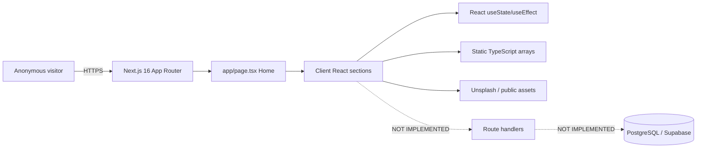
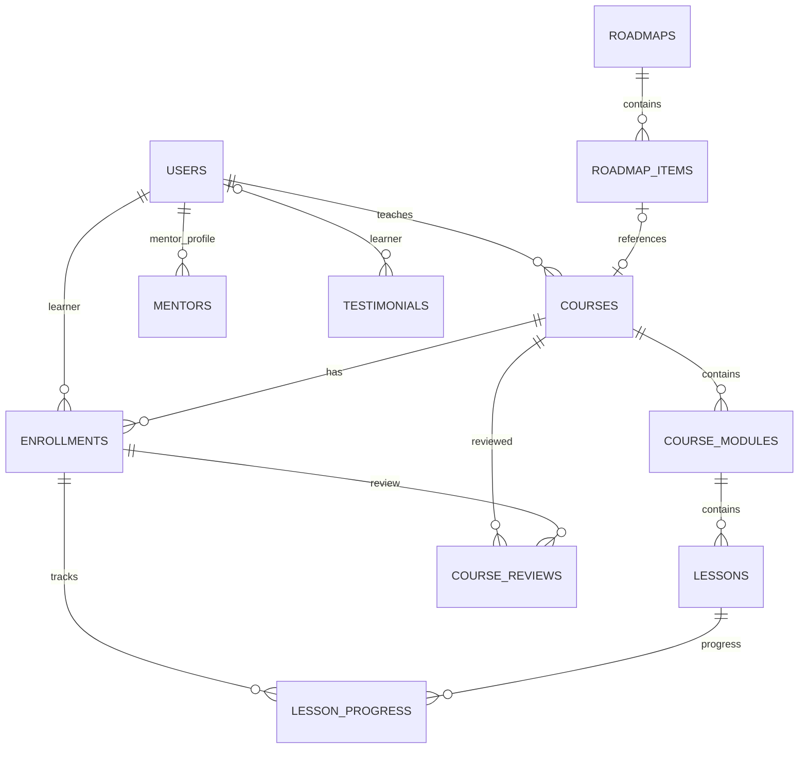
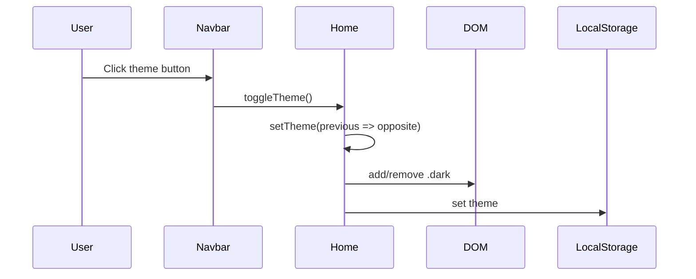
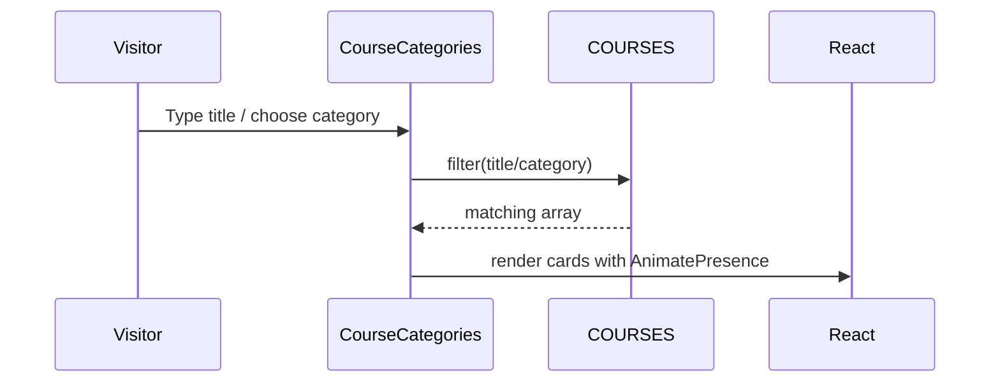
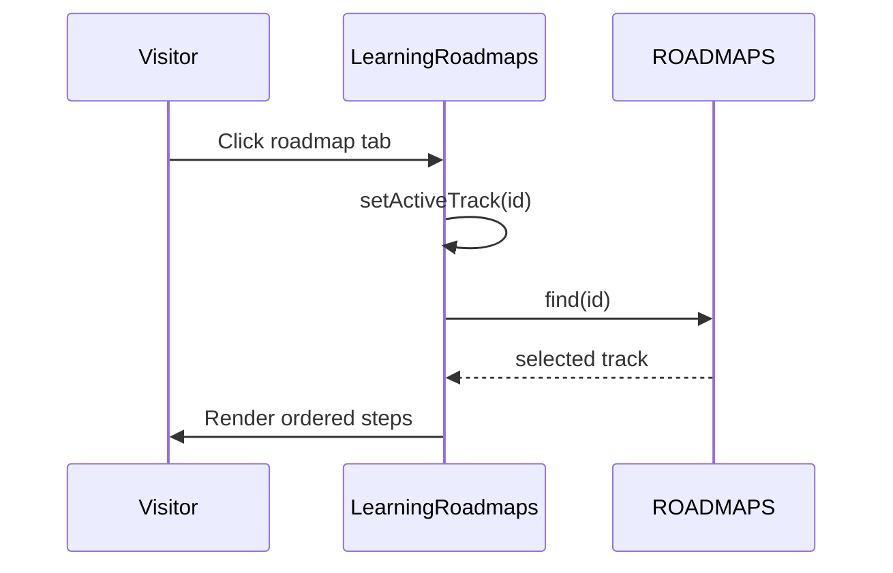
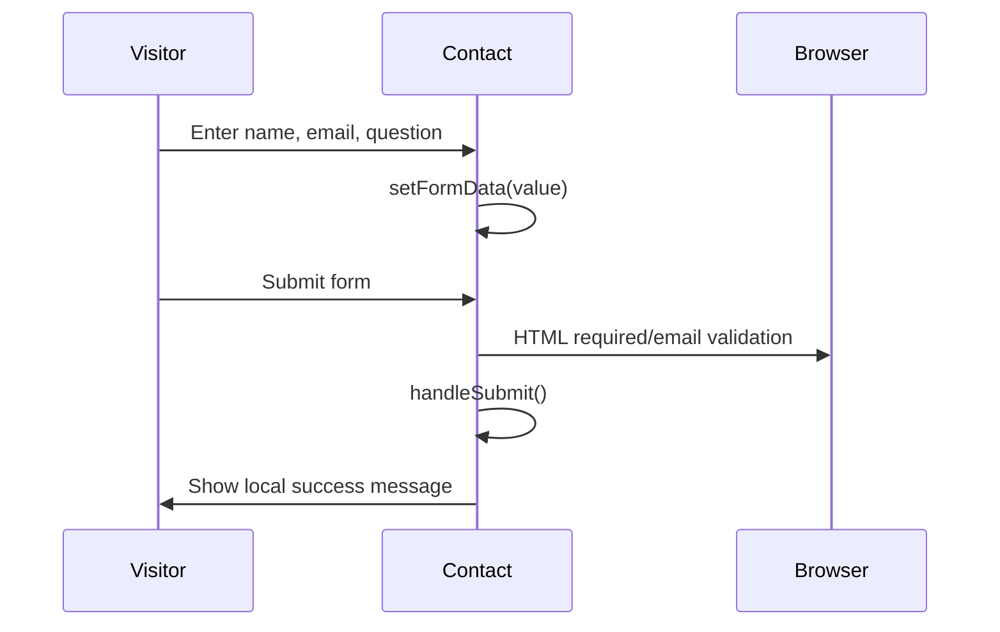
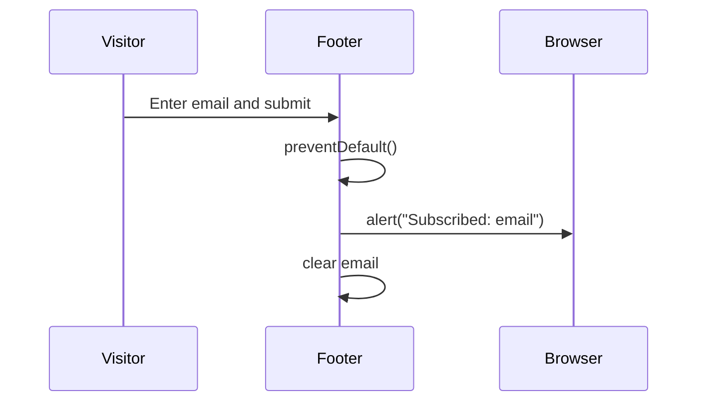
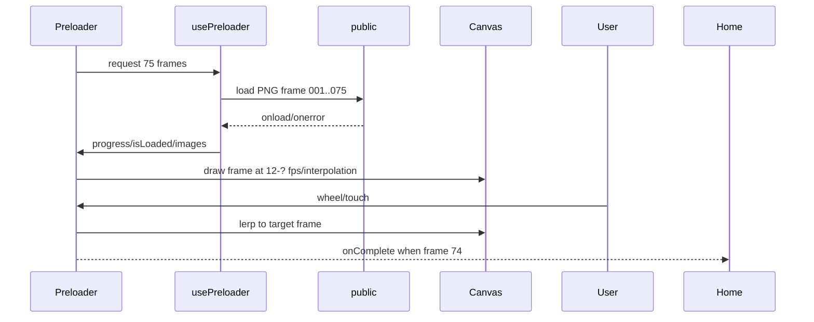

# GM Techies Academy – Interview Preparation

> Repository: `Gauri1466/Creative_Website`  
> Evidence basis: actual files at repository commit `8d1e9b58a4069b263173c651b758fd3605d6747b`  
> Important: This is an incomplete frontend prototype. Supabase, PostgreSQL, authentication, dashboard, and CRUD are **NOT IMPLEMENTED** unless explicitly stated otherwise. The README lists future architecture and database plans; that is not proof of current implementation.

## 1. Project Map

### Problem and users

GM Techies is a technology-education landing experience. It presents courses, internships, interview preparation, learning roadmaps, technical skills, mentors, testimonials, and contact options. Real implemented users are only anonymous website visitors. Course browsing, internships, roadmaps, and contact interaction are static/client-side demonstrations.

Evidence: `app/page.tsx`, `Home()` composes the public sections; `components/sections/CourseCategories.tsx`, `CourseCategories()` owns a fixed `COURSES` array; `components/sections/FeaturedInternships.tsx`, `INTERNSHIPS` is fixed; `components/sections/Contact.tsx`, `Contact()` only changes local React state.

### Current tech stack

- Next.js 16.2.9 App Router and React 19.2.4: `package.json`
- TypeScript 5: `package.json`, strict mode in `tsconfig.json`
- Tailwind CSS 4: `package.json`, `postcss.config.mjs`, `app/globals.css`
- Framer Motion 12, Lenis 1.3, GSAP, DotLottie/Lottie: `package.json`
- External Unsplash images and an external Lottie host: `components/sections/CourseCategories.tsx`, `components/preloader/Preloader.tsx`
- Vercel homepage in repository metadata: repository setting only; deployment configuration is **UNCLEAR**.

### Folder structure

| Path | Responsibility |
|---|---|
| `app/layout.tsx` | Root layout, Google fonts, metadata, global CSS. `RootLayout()` wraps every route. |
| `app/page.tsx` | Home route composition, theme state, smooth scrolling. `Home()` is a client component. |
| `app/globals.css` | Theme variables, Tailwind theme values, global styles, button and glass effects. |
| `components/sections/` | Public-page React sections such as course search, internships, roadmap, mentor, contact. |
| `components/preloader/` | Loading experience, 75-frame image loading, canvas scrubbing, progress UI. |
| `public/assets/` | Local images and 75 PNG preloader frames. |
| `public/hero-animation.json` | Lottie-style animation JSON asset. |
| `package.json` | Dependencies and npm scripts. |
| `next.config.ts` | Empty Next.js configuration. |
| `tsconfig.json` | Strict, no-emit TypeScript configuration. |

No `app/api/`, `middleware.ts`, `supabase/`, `prisma/`, `drizzle/`, migration, test, or admin directory exists.

### Environment variables

**NOT IMPLEMENTED / NO CODE REFERENCES.** No `.env*` file or environment-variable read is present. The README's `DATABASE_URL`, `AUTH_SECRET`, `AUTH_URL`, `STORAGE_*` names are suggestions, not working configuration.

### External services

- Unsplash-hosted course and mentor images: `components/sections/CourseCategories.tsx`
- External DotLottie JSON URL: `components/preloader/Preloader.tsx`, `DotLottieReact`
- Google Fonts through `next/font/google`: `app/layout.tsx`
- Supabase: **NOT IMPLEMENTED**. Package and imports do not exist.
- PostgreSQL: **NOT IMPLEMENTED**. No connection or ORM exists.
- Cloud/image storage: **NOT IMPLEMENTED**.

## 2. High-Level Design

### Components and responsibilities

- `RootLayout` — renders common HTML, fonts, metadata and body: `app/layout.tsx`, `RootLayout()`.
- `Home` — owns theme state, Lenis setup and section composition: `app/page.tsx`, `Home()`.
- `Navbar` — navigation, mobile drawer and theme button: `components/sections/Navbar.tsx`, `Navbar()`.
- `CourseCategories` — static course cards plus browser-side search/category filtering: `components/sections/CourseCategories.tsx`, `CourseCategories()`.
- `FeaturedInternships` — static internship card list: `components/sections/FeaturedInternships.tsx`, `FeaturedInternships()`.
- `LearningRoadmaps` — static track selector and timeline: `components/sections/LearningRoadmaps.tsx`, `LearningRoadmaps()`.
- `Contact` — local form state and fake success state: `components/sections/Contact.tsx`, `Contact()`.
- `Footer` — local newsletter `alert()`: `components/sections/Footer.tsx`, `Footer()` / `handleSubscribe()`.
- `usePreloader` — loads 75 public PNG images: `components/preloader/usePreloader.ts`, `usePreloader()`.
- `Preloader` — wheel/touch scrubbing and fade out: `components/preloader/Preloader.tsx`, `Preloader()`.

### Architecture



No server action, route handler or database is in the actual repository tree.

### Typical page request

1. Browser requests `/` through Next.js.
2. `RootLayout()` supplies metadata, fonts and global CSS: `app/layout.tsx`.
3. `Home()` renders as a client component and initializes theme and Lenis in effects: `app/page.tsx`.
4. `Home()` composes static section components.
5. React renders fixed arrays locally; no HTTP fetch is used.
6. Visitor interactions update component state or `localStorage`.
7. There is no server, API or database response in the current flow.

### Data flow

Data is hardcoded in TypeScript constants or entered as React state. It does not persist. Theme data persists only in browser `localStorage`; course/filter/contact/newsletter values remain in memory.

### Authentication model

**NOT IMPLEMENTED.** `Navbar.tsx`, `Navbar()` shows `Sign In` and `Get started` as hash links to `#login` and `#contact`, not real authentication. No login page, session, JWT, cookie, Supabase auth, middleware or role check exists. There is no admin role check and no protected route.

### External integrations

Google Fonts are loaded at build/runtime via `next/font/google`; Unsplash images are loaded in cards; DotLottie loads remotely. None has server-side credentials. Supabase is **NOT IMPLEMENTED**.

### Deployment

The repository homepage points to Vercel, and there are standard Next.js scripts: `package.json`. `next.config.ts` contains no deployment settings. CI/CD workflow files are **NOT IMPLEMENTED**. Database deployment is **NOT IMPLEMENTED**.

## 3. Low-Level Design

### Database schema

**NOT IMPLEMENTED.** The repository has no migrations, models or SQL. The README proposes tables, but they are not real code. Therefore, no real keys, constraints or indexes exist.

The README-proposed relationships are:



This is a README design diagram, not a running schema. Evidence: `README.md` lines 174-335 describe proposed models and `README.md` lines 381-388 identify database work as future priorities.

No SQL can be shown for RLS because RLS policies are **NOT IMPLEMENTED**. Supabase clients, anon key, and service-role key are **NOT IMPLEMENTED**.

### API table

| Method | Route | Auth/role | Validation | Response | Status |
|---|---|---|---|---|---|
| `N/A` | `/api/courses` | N/A | N/A | N/A | N/A |
| `N/A` | `/api/auth/*` | N/A | N/A | N/A | N/A |
| `N/A` | `/api/contact` | N/A | N/A | N/A | N/A |

Only browser interactions exist. The README-proposed routes in `README.md` lines 337-362 are **NOT IMPLEMENTED**. There are no route handlers or status codes.

### Key modules/functions

- `Home()` — theme and Lenis lifecycle: `app/page.tsx`.
- `CourseCategories()` / local `filteredCourses` — array filtering: `components/sections/CourseCategories.tsx`.
- `LearningRoadmaps()`, `selectedTrack` — finds one active roadmap: `components/sections/LearningRoadmaps.tsx`.
- `Contact()`, `handleSubmit()` — local success transition: `components/sections/Contact.tsx`.
- `Footer()`, `handleSubscribe()` — browser alert and state reset: `components/sections/Footer.tsx`.
- `usePreloader()` — loads image frame assets concurrently: `components/preloader/usePreloader.ts`.
- `Preloader()` — scrubs frames with wheel/touch: `components/preloader/Preloader.tsx`.
- `Navbar()` — mobile menu state: `components/sections/Navbar.tsx`.

### Middleware

**NOT IMPLEMENTED.** No `middleware.ts`, auth middleware or route protection exists.

### Frontend state

- `theme`: parent `Home` state, mirrored to root class and `localStorage`: `app/page.tsx`.
- `searchQuery`, `selectedCategory`, `currentPage`: `CourseCategories` state: `components/sections/CourseCategories.tsx`.
- `activeTrack`: selected roadmap: `components/sections/LearningRoadmaps.tsx`.
- `formData`, `isSubmitted`: contact state: `components/sections/Contact.tsx`.
- `email`: newsletter state: `components/sections/Footer.tsx`.
- Preloader progress and frame state uses `useState`, `useRef`, requestAnimationFrame: `components/preloader/Preloader.tsx`.

### Error handling

- Preloader image failures increment progress and resolve so loading continues: `usePreloader()`, `img.onerror`.
- Browser form fields rely on HTML `required` and `email` input types: `components/sections/Contact.tsx`, `components/sections/Footer.tsx`.
- No API error handling, exception boundary, fetch retry or persisted error state exists.

## 4. Core Flows and Logic

### 1. Theme switching

UI → browser state → DOM/localStorage → UI.

1. `Home()` initializes `theme` as `dark`: `app/page.tsx`, `Home()`.
2. `useEffect` reads `localStorage.theme`.
3. Another effect adds/removes `dark` on `<html>` and writes the theme.
4. `Navbar()` calls `toggleTheme()` for desktop/mobile: `components/sections/Navbar.tsx`, `Navbar()`.



```text
function toggleTheme(theme):
    if theme == light: return dark
    else: return light

on theme change:
    update <html>.classList
    localStorage[theme] = theme
```

Edges handled: initial saved theme, default dark. Not handled: cross-tab synchronization, invalid saved values, SSR hydration mismatch. Time complexity: O(1).

### 2. Course search and category filtering

UI → local array filtering → React cards.

1. `CourseCategories()` initializes search/category/page state.
2. Text input updates `searchQuery`.
3. Category button updates `selectedCategory`.
4. `COURSES.filter(...)` checks title and category.
5. The matching array is animated into the grid.



```text
filtered = []
for course in COURSES:
    titleMatch = course.title.lower().includes(query.lower())
    categoryMatch = category == All or course.category == category
    if titleMatch and categoryMatch: filtered.add(course)
```

Handled: case-insensitive title search and one category. Not handled: empty search trimming, pagination, server data, 100+ course claim, level filtering, debounce. Time complexity: O(n), memory O(k), n = fixed course count.

### 3. Roadmap selection

UI → local roadmap lookup → timeline rendering.

1. `LearningRoadmaps()` defaults to `track-1`.
2. Tab click sets `activeTrack`.
3. `ROADMAPS.find(...)` gets selected track.
4. Steps are displayed in alternating columns.



```text
selected = find(ROADMAPS, id == activeTrack)
if selected == null: selected = ROADMAPS[0]
for index, step in selected.steps:
    render step at left if even else right
```

Handled: unknown ID fallback. Not handled: persistence, personalization, progress, API data. Time O(n) for lookup and O(s) for steps.

### 4. Contact form

UI state → browser success UI. It does not send or persist a message.

1. The form stores fields in `formData`.
2. Browser validation checks required/email fields.
3. `handleSubmit()` checks truthy fields.
4. `isSubmitted` changes and a success card appears.
5. The code schedules field reset after 500 ms.



```text
preventDefault(formSubmit)
if name and email and question:
    isSubmitted = true
    schedule reset(formData) after 500ms
else:
    remain in form
```

Handled: HTML validation, success UI, reset. Not handled: network persistence, server validation, spam/rate limiting, success/error state from server, accessibility feedback, actual delivery. Time O(1).

### 5. Newsletter subscription

UI state → alert. It does not subscribe the user.

1. `Footer()` stores email in React state.
2. `handleSubscribe()` prevents default submission.
3. An alert shows `Subscribed: email`.
4. State becomes empty.



Handled: browser `required` and `type=email`. Not handled: provider, storage, duplicate handling, consent, double-submit, actual unsubscribe. Time O(1).

### 6. Preloader frame loading and scrubbing

UI → public assets → canvas.

1. `usePreloader()` creates 75 `Image` objects for frame paths.
2. Load success/error increments shared count and sets progress.
3. `Preloader()` waits for 100% and reveals the canvas after 500 ms.
4. Wheel/touch updates target frame; RAF lerps current frame.
5. Frame 74 sets fading-out state and calls `onComplete()` after exit animation.



```text
load 75 images concurrently
for each success or failure:
    increment loadedCount
    progress = loadedCount / 75

on wheel/touch:
    targetFrame = clamp(targetFrame + delta*sensitivity, 0, 74)

on each RAF:
    currentFrame += (targetFrame-currentFrame)*0.12
    draw nearest frame
if round(currentFrame) >= 74:
    fade out and call onComplete
```

Handled: failed frames continue, DPR resize, no vertical page scroll. Not handled: memory pressure, reduced-motion preference, cancellation of delayed timeout, image decode, keyboard scrubbing. Time O(n) for initial loading; per-frame draw is O(1) in algorithm terms, but canvas/image operations cost pixels.

## 5. Design Decisions

| Core logic | Why this approach | Alternatives | Advantages | Disadvantages | When it breaks | How I would improve |
|---|---|---|---|---|---|---|
| Theme in React + localStorage | `app/page.tsx`, `Home()` has only one global theme state. | SSR cookie, data-theme with CSS only | Simple; instant across section props | Not server-known; can flash wrong theme | Browser storage blocked or cross-device expected | Theme cookie/provider, `suppressHydrationWarning`, OS default |
| Client-side course filter | Fixed `COURSES` array in `components/sections/CourseCategories.tsx`, `CourseCategories()` | API + database search | Fast for 3 cards; no backend needed | Not scalable; `100+` text is misleading | Large list or dynamic content | Server/DB pagination and indexed search |
| Static roadmap tabs | Fixed `ROADMAPS` array in `LearningRoadmaps`, `LearningRoadmaps()` | CMS/database | Easy prototype | No personalization or progress | Admin needs updates or enrollments | Postgres roadmaps/items, published status |
| Fake contact submission | `Contact()`, `handleSubmit()` only uses browser state | Server action/route handler | Gives UI preview | Message is lost | User expects delivery | Validate server-side, persist, email, rate limit |
| Browser-only newsletter alert | `Footer()`, `handleSubscribe()` | Supabase/table/email provider | Fast demo | No subscription exists | User leaves or owner expects leads | Store consent and email; provider integration |
| Canvas frame preloader | `Preloader()` and `usePreloader()` use public PNG sequence | CSS/one SVG/Lottie only | Premium visual effect | 75 images consume bandwidth/memory | Slow network, mobile low-memory | Compress/AVIF, lazy-load, reduced motion fallback |

## 6. Challenges and Weaknesses

| Severity | Problem | Real handling/failure | Fix |
|---|---|---|---|
| Critical | No database or Supabase | README plans only; no package, client, migration or SQL exists. | Add Supabase/Postgres, migrations, environment variables and server clients. |
| Critical | No authentication or RBAC | `Navbar()` has only hash links: `components/sections/Navbar.tsx`, `Navbar()`. | Add Supabase Auth or secure sessions, protected layouts/middleware and server-side role checks. |
| Critical | No RLS policies | No `supabase/migrations/*.sql` or RLS SQL exists. | Enable RLS for every table and write policies for owner/admin/public access. Never expose service-role key to browser. |
| Critical | Contact is not sent | `handleSubmit()` sets UI state only: `components/sections/Contact.tsx`. | Server action/route handler, Zod validation, persistence/email, CSRF/rate limits. |
| High | Newsletter is fake | `handleSubscribe()` calls `alert()`: `components/sections/Footer.tsx`. | Provider API server-side, consent checkbox, double opt-in and duplicate key. |
| High | Apply links are placeholders | `href="#apply-${item.id}"`: `FeaturedInternships.tsx`, `FeaturedInternships()`; no matching real target. | Real application URLs or authenticated server route. |
| High | Sign-in links are placeholders | `href="#login"`: `components/sections/Navbar.tsx`, `Navbar()`. | Implement `/login`, session cookie and redirect. |
| High | No server input validation | No server endpoints; only browser `required` and `type=email`: `Contact.tsx`. | Zod schema on server actions/routes and normalize values. |
| High | External image security/reliability | Course cards use Unsplash URLs and raw ``: `CourseCategories.tsx`. | Use `next/image` remote config or self-hosted/CDN images. |
| High | Remote Lottie dependency | Preloader pulls from `lottie.host`: `Preloader.tsx`, `DotLottieReact`. | Self-host asset or remove remote runtime dependency. |
| Medium | 75-frame loading is expensive | `usePreloader()` loads all frames concurrently: `usePreloader.ts`. | Add lazy loading, compression, decode, request/viewport awareness and timeout fallback. |
| Medium | `page.tsx` is entirely client-side | `app/page.tsx` starts with `'use client'`, but only theme and Lenis need client code. | Move static sections to server components; isolate interactive islands. |
| Medium | Smooth-scroll RAF never tracks cancellation? | `app/page.tsx`, `Home()` starts one recursive `requestAnimationFrame` and cleanup only destroys Lenis. | Store/ cancel RAF ID in effect cleanup. |
| Medium | Pagination is cosmetic | `CourseCategories` stores `currentPage` but always renders all filtered cards: `CourseCategories.tsx`. | Implement real page size and offset/cursor in API/DB. |
| Medium | Duplicate filtering logic risk | Search and category are derived in component only. | Move query into typed service/repository and test. |
| Medium | No test directory/framework | Repository tree has no tests. `package.json` has no test script. | Add Vitest/React Testing Library and route/server-action integration tests. |
| Medium | Accessibility gaps | Several icon-only controls have labels, but no skip link/focus management and form success uses non-role status. | Add skip link, focus management, `role=status`, keyboard and reduced motion. |
| Medium | Preloader keyboard is absent | `Preloader()` listens to wheel/touch only: `Preloader.tsx`. | Add keyboard controls and system reduced-motion fallback. |
| Medium | No error boundaries/loading states | No `loading.tsx`, `error.tsx` or route API. | Add App Router loading/error boundaries and server fallbacks. |
| Low | README overclaims implementation | README says full-stack features and active flows, but code lacks them. | Mark roadmap separately and update status accurately. |
| Low | External `href="#..."` navigation | Navbar/Footer/Apply links do not lead to real pages. | Implement real routes and links. |
| Medium | Missing database indexes | No schema exists; README only recommends indexes. | Create indexes on slugs, foreign keys, status/category and timestamps. |
| Medium | Missing concurrency control | No database mutations. | Use transactions, unique constraints and row locks for enrollment/draft publish. |

## 7. Resume Claim Check

| Claim | Status | Evidence and strict conclusion |
|---|---|---|
| 1. Full-stack education platform where visitors browse courses, instructors, internships, learning resources | **Partly** | Public UI exists in `app/page.tsx`, `CourseCategories()`, `FeaturedInternships()`, `Mentors()`, `LearningRoadmaps()`, but all data is static/hardcoded and there is no backend/resources/instructors persistence. It is not full-stack. |
| 2. Secure admin dashboard to create, edit, publish and remove courses, teacher profiles, internship listings | **Not found** | No dashboard, admin route, CRUD or secure operation exists. README describes future flows only in `README.md`. |
| 3. Role-based access control separating public browsing from admin content management | **Not found** | No roles, auth provider, middleware or protected route exists. `Navbar()` only displays `Sign In` placeholders. |
| 4. Content and admin accounts persisted in PostgreSQL with relational models | **Not found** | No PostgreSQL package/client/model/migration exists. README database design is proposed but unimplemented. |

The final line in the user's instruction means this should be called a frontend/prototype project, not a completed full-stack project.

## 8. Interviewer Cross-Questions

### 1. Is this Next.js full-stack application or frontend?
**Model answer:** It is a frontend prototype. `app/page.tsx` uses a client component and no API route, database client or server action exists. `package.json` contains UI libraries, but not Supabase/Postgres. Evidence: `app/page.tsx`, `Home()` and `package.json`. **Trap:** Do not repeat README claims as implemented facts.

### 2. Why is `app/page.tsx` a client component?
**Model answer:** `Home()` uses `useState`, `useEffect`, Lenis and Framer Motion. That code requires the browser. Evidence: `app/page.tsx`, `Home()`. **Trap:** Entirely static sections do not need this boundary; it could be split into server/client islands.

### 3. What happens in `RootLayout()`?
**Model answer:** It sets Inter and Plus Jakarta fonts, metadata and global CSS. Evidence: `app/layout.tsx`, `RootLayout()`. **Trap:** Layout is a server component; it is not a global state store.

### 4. How is theme stored?
**Model answer:** `Home()` stores the theme in React state and `localStorage`; it toggles the `dark` HTML class. Evidence: `app/page.tsx`, `Home()`, `toggleTheme()`. **Trap:** It is a browser preference, not an authenticated account setting.

### 5. What is the complexity of course filtering?
**Model answer:** It performs O(n) filtering and O(k) result storage for n fixed courses. Evidence: `COURSES.filter()` in `components/sections/CourseCategories.tsx`, `CourseCategories()`. **Trap:** The UI cannot paginate because `currentPage` is not used by filtering.

### 6. Why can the search claim “100+ courses” be wrong?
**Model answer:** `COURSES` has only three entries, course 1 to 3. Evidence: `CourseCategories.tsx`, `COURSES`. **Trap:** Marketing copy does not prove data availability.

### 7. What is the Supabase implementation?
**Model answer:** There is no Supabase implementation. No package or `createClient` call exists. **Trap:** The extra focus and README must not be presented as current code.

### 8. Are there any migrations or RLS SQL?
**Model answer:** No. The repository tree has no `supabase/migrations` or SQL file. **Trap:** Do not invent a policy; there are no actual RLS policies.

### 9. How should a Supabase browser client be created safely?
**Model answer:** A browser client may use `NEXT_PUBLIC_SUPABASE_URL` and the publishable/anon key, never a service-role secret. Evidence: neither key nor client exists in this repo. **Trap:** The service-role key must stay server-only.

### 10. How are sessions checked?
**Model answer:** They are not checked. The Sign In link goes to `#login`: `components/sections/Navbar.tsx`, `Navbar()`. **Trap:** A hash link is not authentication.

### 11. How could course draft/publish be modeled?
**Model answer:** A README proposes `DRAFT`, `PENDING`, `PUBLISHED`, `UNPUBLISHED` states, but no model exists. Evidence: `README.md`, proposed `courses.status`. **Trap:** Planned fields are not implemented schema.

### 12. What is the contact flow?
**Model answer:** `handleSubmit()` prevents default submission, checks truthy state and switches to a success card. It does not make a network request or write a database row. Evidence: `components/sections/Contact.tsx`, `Contact()`. **Trap:** It is a demo, not a working support form.

### 13. What server-side validation does Contact have?
**Model answer:** None. The only validation is HTML `required` and `type=email`. **Trap:** Browser validation can be bypassed, so server validation is mandatory.

### 14. What does `usePreloader()` do?
**Model answer:** It creates 75 `Image` objects for PNG frames and resolves success or failure. Evidence: `components/preloader/usePreloader.ts`, `usePreloader()`. **Trap:** Loading an image with an error still increments the count, so a broken frame can become a blank canvas.

### 15. How does frame scrubbing work?
**Model answer:** Wheel/touch delta changes `targetFrameRef`; RAF lerps toward it and draws the nearest frame. Evidence: `components/preloader/Preloader.tsx`, `Preloader()`. **Trap:** It targets frame 74 but does not have a robust timeout for asset failures.

### 16. What is the preloader time complexity?
**Model answer:** Loading starts 75 requests concurrently, O(75) from the fixed set. Drawing is a constant frame selection per tick plus canvas pixel cost. Evidence: `usePreloader()` and `drawFrame()`. **Trap:** Concurrency can overload slow networks and memory.

### 17. Why could Lenis use a recursive RAF issue?
**Model answer:** `Home()` schedules one Lenis RAF inside another without storing the loop ID. Cleanup destroys Lenis but may not cancel the scheduled chain. Evidence: `app/page.tsx`, `Home()`. **Trap:** Strict development remounts can expose lifecycle bugs.

### 18. How should internship data be persisted?
**Model answer:** Add an `internships` table with status, dates and application URL. This is only a README proposal. Evidence: `README.md` and `INTERNSHIPS` in `FeaturedInternships.tsx`. **Trap:** Do not claim CRUD because the static array only exists.

### 19. How would you implement course search in production?
**Model answer:** Use debounced query params, server filtering and database indexes on status/category/title. Return paginated results and published courses only. **Trap:** The browser-only fixed array is not scalable.

### 20. What is a missing index in this repo?
**Model answer:** Since no database exists, every recommended index is missing. The README suggests course slug/category/status and foreign keys, but has no SQL. **Trap:** Do not say a specific index exists.

### 21. What concurrency issue is present in enrollment proposals?
**Model answer:** No enrollment code exists. A future implementation must prevent duplicate (learner, course) rows with a unique constraint and use transactions. Evidence: README only. **Trap:** UI checks are insufficient for duplicate prevention.

### 22. How should draft-to-publish authorization work?
**Model answer:** Server code must verify the caller, course ownership/approval state and admin role before state transition. Frontend links cannot enforce this. **Trap:** There is no actual admin or teacher implementation to defend.

### 23. What is the biggest security weakness?
**Model answer:** The frontend has no authentication or server authorization, and the contact/newsletter flows are only local UI. Therefore no protected resource or secret handling exists yet. **Trap:** Do not claim secrets are safe because none are visible.

### 24. What testing gaps exist?
**Model answer:** No test framework, test files or test script exist. `package.json` only defines dev/build/start/lint. **Trap:** Lint is not a functional test suite.

### 25. What would you say honestly in an interview?
**Model answer:** I would say it is a Next.js 16 responsive frontend prototype with strong UI and animation work. I would not call it full-stack until database, auth, route handlers, RLS and CRUD are implemented. **Trap:** Do not overstate; explain the README as future design.

### 8 Feature Tasks

#### A. Working contact form
Steps:
1. Add `/api/contact` or a Next Server Action.
2. Validate with Zod/HTML plus server checks.
3. Insert `contact_messages` in Postgres.
4. Return 201/validation/rate-limit responses.
5. Show loading, success and error UI.

```tsx
// components/sections/Contact.tsx
const result = await fetch('/api/contact', {
  method: 'POST',
  headers: { 'content-type': 'application/json' },
  body: JSON.stringify(formData),
});
if (!result.ok) throw new Error('Unable to send message');
setIsSubmitted(true);
```

#### B. Supabase authentication
Steps:
1. Configure public URL/anon key server/browser correctly.
2. Add Supabase auth login/callback.
3. Store HTTP-only session or framework-supported cookies.
4. Check session in Server Components/actions.
5. Add role lookup and server authorization.

```ts
const supabase = createBrowserClient(
  process.env.NEXT_PUBLIC_SUPABASE_URL!,
  process.env.NEXT_PUBLIC_SUPABASE_ANON_KEY!
);
const { data } = await supabase.auth.signInWithPassword({ email, password });
```

#### C. Course database and published browsing
Steps:
1. Create `courses`, `course_modules`, `lessons` migrations.
2. Add RLS/public read policy for published courses.
3. Replace `COURSES` with a server query.
4. Add search params and pagination.
5. Add loading and not-found states.

```sql
create index idx_courses_status_category on courses(status, category);
create index idx_courses_slug on courses(slug);
```

#### D. Admin CRUD
Steps:
1. Add `/admin/courses` protected layout.
2. Check `role = 'ADMIN'` server-side.
3. Implement create/update/delete Server Actions.
4. Validate ownership/state and status transitions.
5. Add audit log writes and tests.

```ts
if (profile.role !== 'ADMIN') throw new Error('FORBIDDEN');
await tx.course.update({ where: { id }, data: courseInput });
```

#### E. Draft/publish workflow
Steps:
1. Add `DRAFT -> PENDING -> PUBLISHED/UNPUBLISHED` transition rules.
2. Restrict teacher update ownership.
3. Restrict approval to admin.
4. Use transaction and unique slug.
5. Add audit logging.

```ts
if (actor.role === 'ADMIN' && course.status === 'PENDING') {
  await publishCourse(course.id);
}
```

#### F. Image upload
Steps:
1. Validate MIME type, size and dimensions server-side.
2. Create signed upload URL or server upload.
3. Store public URL in course/mentor record.
4. Use responsive Next Image/remote config.
5. Delete orphaned images.

```ts
const allowed = ['image/jpeg', 'image/png', 'image/webp'];
if (!allowed.includes(file.type) || file.size > 5_000_000) {
  throw new Error('Invalid image');
}
```

#### G. Newsletter persistence
Steps:
1. Create `newsletter_subscribers` table.
2. Add unique email and consent timestamp.
3. Server validate/double-opt-in.
4. Add unsubscribe token.
5. Integrate email provider server-side.

```sql
create table newsletter_subscribers (
  email text primary key,
  consent_at timestamptz not null default now()
);
```

#### H. Automated tests
Steps:
1. Add Vitest and React Testing Library.
2. Test course filtering, theme, form and roadmap switching.
3. Add Playwright browser tests.
4. Mock network and test loading/error states.
5. Add CI build, lint and test workflow.

```tsx
it('filters courses by category', () => {
  render(<CourseCategories />);
  fireEvent.click(screen.getByRole('button', { name: 'Code' }));
  expect(screen.getByText('Python for Data Science')).toBeVisible();
});
```

## 9. Cheat Sheet

### 60-second explanation

“This repository is a Next.js 16 and React 19 frontend prototype for an education platform called GM Techies. It implements responsive public sections, static course filtering, roadmap tabs, theme persistence, contact/newsletter demo UI and an animated canvas preloader. It does not contain Supabase, PostgreSQL, route handlers, authentication, admin dashboards or CRUD. The README is a future architecture plan, so I would describe this honestly as an incomplete frontend project that is ready for backend integration.”

### Key numbers

- Next.js 16.2.9
- React 19.2.4
- 75 preloader PNG frames
- 3 hardcoded courses
- 3 hardcoded internships
- 3 hardcoded roadmaps
- 11 major sections in `Home()`
- 0 API route directories
- 0 database/migration directories
- 0 test files visible
- 0 real authentication integrations

### Five weaknesses to admit

1. There is no backend or database.
2. Contact and newsletter submissions do not persist or send.
3. Sign-in and admin functions are not implemented.
4. Courses and internships are fixed arrays, not dynamic data.
5. There are no automated tests or RLS policies.

### Ten facts to remember

1. `app/page.tsx`, `Home()` is the main page and is a client component.
2. `app/layout.tsx`, `RootLayout()` provides fonts, metadata and global CSS.
3. `CourseCategories()` filters three fixed course objects locally in O(n).
4. `LearningRoadmaps()`, `selectedTrack` chooses one fixed roadmap.
5. `Contact()`, `handleSubmit()` only updates local UI state.
6. `Footer()`, `handleSubscribe()` only calls `alert()`.
7. Theme uses React state plus `localStorage` and the root `.dark` class.
8. `usePreloader()` loads all 75 PNG frame files.
9. `Preloader()` uses wheel/touch plus RAF lerping to scrub frames.
10. Supabase, RLS, admin RBAC, PostgreSQL and CRUD are all **NOT IMPLEMENTED**.
